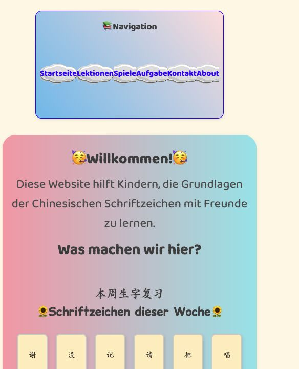
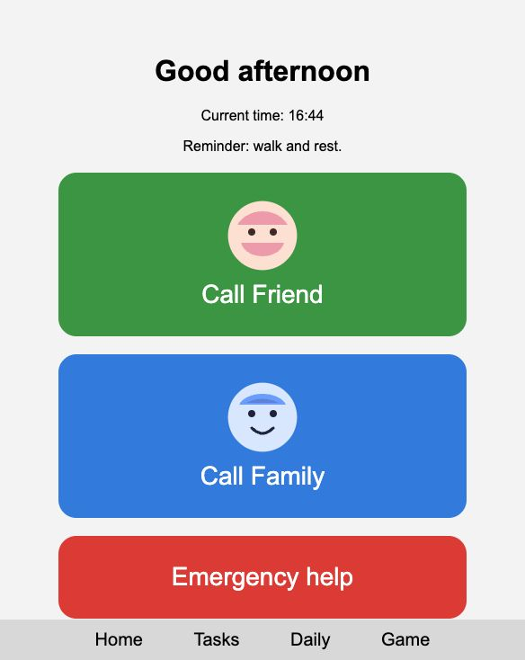

# Small tools for everyday life

Web-Projekte von Tao: Sprache lernen, Alltag vereinfachen und eigene Ideen ausprobieren. HTML, CSS und JavaScript – mit direktem Einstieg in jedes Projekt.

**[Open the project gallery →](https://lilarosa.github.io/frontend-projects/)**

## Explore

| Projekt | Wofür? | Stand | Einstieg |
|---|---|---|---|
| **Chinese Learning** | Chinesische Zeichen und Sprache für Kinder entdecken | Web-Lernprojekt | [Demo](https://lilarosa.github.io/frontend-projects/projects/01_chinesisch-lernen/) · [Code](projects/01_chinesisch-lernen/) |
| **Hungary Survival** | Alltag und Sprache in Ungarn erkunden | Web-Guide | [Demo](https://lilarosa.github.io/frontend-projects/projects/02_hungary-survival/) · [Code](projects/02_hungary-survival/) |
| **CareU** | Einfache Tagesroutinen und Familienkontakte ausprobieren | UI-Prototyp | [Demo](https://lilarosa.github.io/frontend-projects/projects/03_careU/) · [Code](projects/03_careU/) |
| **AP1 Study App** | Lernthemen, Quiz und Wiederholung organisieren | Lernwerkzeug | [Demo](https://lilarosa.github.io/frontend-projects/projects/04_ap1-study-app/) · [Code](projects/04_ap1-study-app/) |
| **Chinese Poetry in German** | Chinesische Gedichte mit deutschen Erläuterungen lesen | Web-Lernprojekt | [Demo](https://lilarosa.github.io/frontend-projects/projects/05_chinese-poetry-de/) · [Code](projects/05_chinese-poetry-de/) |
| **Smart Outfit Showcase** | Die Idee eines digitalen Kleiderschranks erkunden | Statischer Prototyp | [Demo](https://lilarosa.github.io/frontend-projects/projects/06_smart-outfit/) · [Code](projects/06_smart-outfit/) |
| **Dream Aquarium** | Fische mit Maus oder Handgesten steuern | Interaktive Web-Demo | [Demo](https://lilarosa.github.io/frontend-projects/projects/07_dream-aquarium/) · [Code](projects/07_dream-aquarium/) |

## Ein Blick in die Projekte

| Chinese Learning | CareU |
|---|---|
|  |  |

## Lokal öffnen

1. Repository herunterladen und entpacken oder mit Git klonen.
2. Für eine schnelle Vorschau `index.html` im Browser öffnen.
3. Für Service Worker und browserbasierte Speicherung einen lokalen Server verwenden. Mit installiertem Python unter Windows im Repository-Ordner:

```sh
py -m http.server 4173 --bind 127.0.0.1
```

Unter macOS/Linux: `python3 -m http.server 4173 --bind 127.0.0.1`.
Danach [http://127.0.0.1:4173](http://127.0.0.1:4173) öffnen. Browserdaten hängen von Browser und Adresse ab.

## Wo gehört was hin?

- `index.html`: gemeinsame Projektgalerie
- `projects/`: ein eigener Ordner je Anwendung, mit README und Startseite
- `docs/screenshots/`: Bilder für die Dokumentation

Die veröffentlichten Projektpfade bleiben stabil. Bilder, Audio und Video gehören zum jeweiligen Projekt und werden zusammen mit dessen Quellcode gepflegt.

## Zusammengehörige Versionen

- **Smart Outfit:** Dieser Ordner enthält nur den statischen Showcase. Backend und mobile Experimente liegen im [eigenen Repository](https://github.com/lilarosa/smartoutfit).
- **Hungary Survival:** Die Galerie-Version liegt hier. Das [separate Repository](https://github.com/lilarosa/hungary-survival) enthält eine eigenständige Version; die Stände werden nicht automatisch synchronisiert.
- **Chinese Learning:** Frühere Kursstände bleiben in [Study-notes](https://github.com/lilarosa/Study-notes) nachvollziehbar; der Demo-Einstieg ist hier.

## Feedback

Ein Fehler, eine unklare Schaltfläche oder eine gute Idee? [Issue öffnen](https://github.com/lilarosa/frontend-projects/issues/new/choose) und den Projektnamen nennen. Ein kurzer Ablauf und das erwartete Ergebnis helfen bei der Verbesserung.

**中文**：这里集中展示我的网页项目。每个项目都有演示和代码入口，欢迎体验后留下具体建议。
